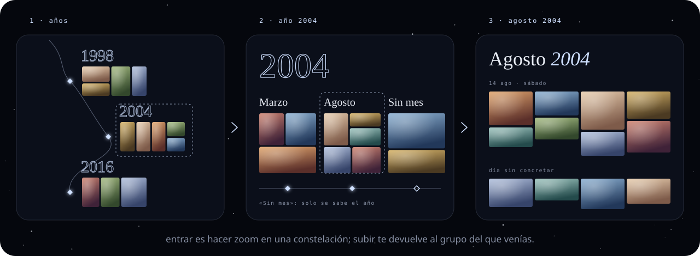
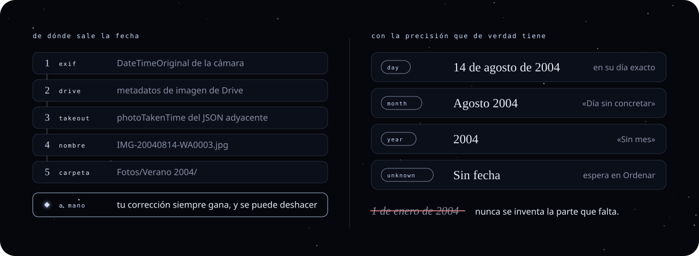
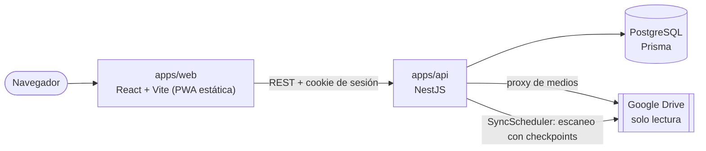

<div align="center">



<br>

[](https://github.com/aadolfo8/linea-de-vida/actions/workflows/ci.yml)


**solo lectura · solo las carpetas que eliges · sin IA**<br>
un archivo de recuerdos para revisar en familia, que se recorre como un cielo nocturno.

[por qué existe](#por-qué-existe) ·
[cómo se recorre](#cómo-se-recorre) ·
[las fechas](#las-fechas-con-honestidad) ·
[privacidad](#privacidad) ·
[decisiones técnicas](#decisiones-técnicas) ·
[arrancarlo](#arrancarlo)

</div>

<br>

## Por qué existe

Las fotos de una familia acaban repartidas en carpetas de Drive, exportaciones de Google
Fotos y chats de WhatsApp. Están guardadas, pero no se ven: abrir una carpeta de 3.000
archivos llamados `IMG-…` no invita a recordar, y buscar «aquel verano» es scroll infinito.

Línea de vida las ordena por fecha y las convierte en una cronología que equilibra dos
cosas: **contemplar** sin prisa y **encontrar** un momento concreto en segundos.

Sin IA, sin reconocimiento facial, sin OCR y sin funciones sociales. Solo tus fotos y sus
fechas, contadas con honestidad.

> [!TIP]
> Sin credenciales de Google puedes entrar con **«Entrar en desarrollo»**: crea una sesión
> local sin fingir acceso a Drive, para ver la interfaz en un par de minutos.

## Cómo se recorre



1. **Años.** Cada año es una constelación: numeral, recuento y un mosaico de sus fotos,
   unidas por un hilo que se dibuja mientras viajas.
2. **Meses.** Entrar en un año es hacer zoom: aparecen sus meses y, si hace falta, un
   grupo «Sin mes» para las fotos de las que solo se sabe el año.
3. **Fotos.** Dentro de un mes, las fotos con su proporción real, agrupadas por día, con
   un «Día sin concretar» al final. Un visor con zoom, gestos y tira de miniaturas.

Recorrido **vertical u horizontal**, con rueda, trackpad, gestos, flechas o el raíl lateral.
Subir (migas, `Esc`, pellizco) te devuelve a la constelación de la que venías.

<table>
<tr>
<th width="33%">🗂️ ordenar</th>
<th width="33%">🖼️ portadas</th>
<th width="33%">📦 google takeout</th>
</tr>
<tr valign="top">
<td>

Un escritorio para repasar fotos sin fecha, asignarlas por carpeta o en lote, y ocultar
las que no quieres ver. Cada cambio se puede **deshacer**: nada de diálogos de «¿seguro?».

</td>
<td>

Elige, en el orden que quieras, qué fotos representan cada año (hasta 8) y cada mes
(hasta 6). El resto se completa solo.

</td>
<td>

Importa exportaciones de Google Fotos leyendo sus JSON adyacentes. Re-importar no
duplica: **la identidad de una foto es su contenido**, no el archivo.

</td>
</tr>
</table>

## Las fechas, con honestidad



<table>
<tr>
<th width="50%">cómo se garantiza</th>
<th width="50%">sus límites, con honestidad</th>
</tr>
<tr valign="top">
<td>

- Cada fecha guarda su **precisión real**: `DAY`, `MONTH`, `YEAR` o `UNKNOWN`. Si solo
  se sabe el año, la foto vive en «Sin mes», nunca en un falso 1 de enero.
- La detección y la corrección manual se guardan **por separado**: quitar una
  corrección restaura exactamente lo detectado.
- El nombre del archivo solo cuenta si el patrón es completo y plausible (WhatsApp,
  cámaras, Pixel, capturas, Signal).
- `createdTime` y `modifiedTime` de Drive **no se usan**: dicen cuándo se subió la foto,
  no cuándo se hizo.

</td>
<td>

- **Un EXIF mal puesto gana.** Si la cámara tenía la hora de fábrica, la foto aparece en 2010. Se corrige a mano, una a una o en lote.
- **Las carpetas mienten a veces.** «Verano 2004» puede tener fotos de septiembre.
  La carpeta es la última pista, y por eso la más débil.
- **Escanear o WhatsApp borra el EXIF.** Una foto antigua escaneada en 2019 solo tiene
  la fecha que le pongas tú.
- **No se infiere nada.** No hay modelo que adivine la década por la ropa: es una
  decisión, no un olvido.

</td>
</tr>
</table>

## Privacidad

- **Drive en solo lectura** (`drive.readonly`), y solo la carpeta elegida y sus
  descendientes: el selector nunca puede abrir ni enumerar todo Drive.
- **Iniciar sesión no es dar acceso a Drive.** Son dos pasos separados; el permiso de Drive
  se pide aparte, con consentimiento incremental, `state` de un solo uso y PKCE.
- **Los tokens nunca llegan al navegador.** El refresh token se guarda cifrado y solo la
  API puede descifrarlo.
- **Un proxy de medios autenticado.** Antes de pedir nada a Drive comprueba que la foto, la
  fuente y la conexión son tuyas. Un id de foto nunca es autorización suficiente.
- **Logs sin datos.** Se registran evento, método, estado y duración; nunca tokens, cookies,
  rutas, nombres de fotos ni identidad.
- **Desvincular revoca.** El token se revoca ante Google y las credenciales se borran.
  Si Google falla, la conexión queda pendiente de revocar sin acceso para nada nuevo.

## Arquitectura



- **Sincronizar no bloquea.** `POST /sync-runs` crea un `SyncRun` en Postgres y responde `202`; el
  `SyncScheduler` de la API lo toma y recorre la carpeta página a página, guarda un checkpoint tras cada una y puede reanudar.
- **Progreso honesto.** Se muestran fotos encontradas y procesadas, nunca un porcentaje que
  Drive no puede respaldar.
- **Borrar con cuidado.** Una foto solo pasa a `MISSING` cuando un escaneo **completo y
  correcto** deja de verla en todas sus copias. Un fallo, un permiso denegado o un escaneo
  parcial nunca reconcilian.

## Decisiones técnicas

| Decisión                         | Por qué                                                                                                                                                                                                      |
| -------------------------------- | ------------------------------------------------------------------------------------------------------------------------------------------------------------------------------------------------------------ |
| **NestJS separado de la web**    | Los secretos de Google, el cifrado y la autorización por recurso viven fuera del navegador y del servidor de la web. La web solo habla REST con una cookie.                                                  |
| **PostgreSQL + Prisma**          | Fotos, copias, carpetas, correcciones y portadas son relacionales. La fecha efectiva es una proyección transaccional de detección o corrección, con índices para la cronología.                              |
| **`SyncRun` como cola**          | Un escaneo de miles de fotos no cabe en una petición HTTP. La fila `SyncRun` es el trabajo (con checkpoint y reintentos) y un planificador en la API la toma con `SKIP LOCKED`. Sin Redis ni proceso aparte. |
| **Identidad por contenido**      | `md5:<hash>:<tamaño>` único por usuario. La misma foto en dos carpetas o en dos exportaciones de Takeout es una foto con dos copias, no dos fotos.                                                           |
| **`DriveAdapter` propio**        | Google no se filtra al dominio, y `MemoryDriveProvider` permite tests y desarrollo sin una cuenta real.                                                                                                      |
| **Un motor de cielo propio**     | Scroll convertido en una pista con inercia, `translate3d` y canvas de estrellas a ~30 fps. Con `prefers-reduced-motion` todo navega sin zoom ni animación.                                                   |
| **Deshacer en vez de confirmar** | Ocultar, fechar o cambiar una portada es reversible, así que no se pregunta: se hace y se ofrece «Deshacer».                                                                                                 |

## Estructura

```
apps/
  api/                   NestJS · Prisma · Vitest
    src/date-resolver.ts   EXIF → Drive → Takeout → nombre → carpeta
    src/filename-date.ts   patrones de fecha en nombres de archivo
    src/sync.service.ts    escaneo con checkpoints y reconciliación
    src/takeout.ts         emparejado de fotos con sus JSON
    src/media-proxy.service.ts   miniaturas y originales autorizados
    src/sync-scheduler.ts  toma los SyncRun en cola, reintenta y purga
    prisma/                esquema y migraciones
  web/                   React 19 · Vite · React Router · Tailwind · PWA
    app/timeline/          las tres profundidades del cielo
    app/ordenar/           el escritorio para fechar y ocultar
    app/portadas/          elegir las fotos de cada constelación
    app/components/sky/    motor del cielo, constelaciones, hilo y raíl
docs/                    referencia técnica, modelo, sync, Takeout, despliegue
DESIGN.md                sistema visual: el «Cielo nocturno»
PRODUCT.md               propósito, usuarios y principios
```

## Arrancarlo

<details>
<summary><b>desarrollo local</b></summary>

Requisitos: Node.js, pnpm 9 y Docker.

```bash
# 1. Variables de entorno (rellena SESSION_SECRET y TOKEN_ENCRYPTION_KEY)
cp .env.example .env

# 2. PostgreSQL (puerto 5433)
docker compose up -d

# 3. Dependencias y migraciones
pnpm install
pnpm --filter @linea-de-vida/api prisma:deploy

# 4. Web + API (la API ejecuta también las sincronizaciones)
pnpm dev
```

Abre **http://localhost:3000**. Para conectar Google Drive de verdad necesitas un cliente
OAuth propio: los pasos están en la
[referencia técnica](docs/technical-reference.md#google-cloud-y-oauth).

</details>

<details>
<summary><b>tests y CI</b></summary>

```bash
pnpm format:check   # formato (oxfmt)
pnpm lint
pnpm typecheck
pnpm test           # Vitest
pnpm build
```

La CI de GitHub Actions ejecuta todo lo anterior en cada push y pull request.

</details>

<details>
<summary><b>despliegue</b></summary>

Producción: **https://linea-de-vida.hidan.es**, con Docker Compose en un VPS detrás de un
Caddy compartido (`/srv/proxy`, fuera de este repo). Cada push a `main` que pasa la CI se
despliega con `.github/workflows/deploy-production.yml`.

Todo el detalle (secrets, preparación del VPS, backup y operación) está en
[Despliegue en producción](docs/production-deployment.md) y en la
[guía de CI/CD en VPS](docs/ci-cd-vps-guia-completa.md).

</details>

## Documentación

| Documento                                                                                           | Contenido                                                                |
| --------------------------------------------------------------------------------------------------- | ------------------------------------------------------------------------ |
| [Referencia técnica](docs/technical-reference.md)                                                   | OAuth, producción, retención, API REST, medios, fechas y sincronización. |
| [DESIGN.md](DESIGN.md)                                                                              | El «Cielo nocturno»: tokens, componentes, movimiento y accesibilidad.    |
| [PRODUCT.md](PRODUCT.md)                                                                            | Propósito, usuarios y principios del producto.                           |
| [Arquitectura](docs/architecture.md) · [Modelo de datos](docs/data-model.md)                        | Cómo está construido por dentro.                                         |
| [Integración con Drive](docs/google-drive-integration.md) · [Sincronización](docs/sync-strategy.md) | Cómo se leen y reconcilian las fotos.                                    |
| [Google Takeout](docs/google-takeout.md)                                                            | Cómo preparar una exportación para importarla.                           |
| [Roadmap](docs/roadmap.md)                                                                          | Fases completadas y siguientes pasos.                                    |

Las ilustraciones de este README se generan con `python docs/readme/generar.py`, con las
mismas tipografías y colores que la web.

---

<div align="center">
<sub>✦ &nbsp;para guardar recuerdos y volver a ellos&nbsp; ✦</sub>
</div>
