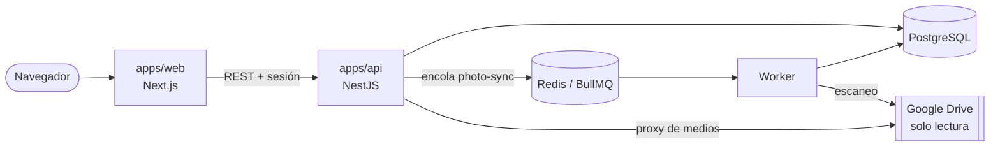

<div align="center">

# ✦ Línea de vida

**Un archivo fotográfico privado que se recorre como un cielo nocturno.**

Tus fotos de Google Drive, ordenadas por fecha y convertidas en constelaciones: un año, un mes, un día.


</div>

---

## Qué es

Línea de vida es un archivo de recuerdos pensado para que una familia los revise junta. Conecta **solo las carpetas de Google Drive que tú eliges**, en **modo de solo lectura**, y las ordena en una cronología que equilibra dos cosas: la contemplación tranquila y encontrar un momento concreto en segundos.

Sin IA, sin reconocimiento facial, sin OCR y sin funciones sociales. Solo tus fotos y sus fechas, contadas con honestidad.

## ✨ Lo que hace

|                            |                                                                                                                                                                                                                          |
| -------------------------- | ------------------------------------------------------------------------------------------------------------------------------------------------------------------------------------------------------------------------ |
| 🌌 **Cielo nocturno**      | La cronología es un cielo oscuro en tres profundidades — **años → meses → fotos** — donde cada periodo es una constelación. Entrar es hacer zoom; subir te devuelve al grupo de origen. Recorrido vertical u horizontal. |
| 📅 **Fechas fieles**       | Cada fecha conserva su precisión real (`YEAR`, `MONTH`, `DAY`, `UNKNOWN`). Si solo se sabe el año, la foto vive en «Sin mes», nunca en un falso 1 de enero.                                                              |
| 🔎 **Detección por capas** | EXIF → metadatos de Drive → `photoTakenTime` de Takeout → nombre del archivo (WhatsApp, Pixel, capturas…) → carpeta. Y siempre puedes corregirla a mano.                                                                 |
| 🗂️ **Ordenar**             | Un espacio para repasar fotos sin fecha, asignarlas por carpeta o en lote, y ocultar las que no quieres ver (de forma reversible).                                                                                       |
| 📦 **Google Takeout**      | Importa exportaciones de Google Fotos leyendo sus JSON adyacentes. Re-importar no duplica: la identidad de una foto es su contenido.                                                                                     |
| 🔒 **Privacidad primero**  | Los tokens y las URLs de Drive nunca llegan al navegador. Las imágenes pasan por un proxy autenticado que comprueba que cada foto es tuya.                                                                               |

## 🏗️ Arquitectura



| Pieza              | Responsabilidad                                                                                     |
| ------------------ | --------------------------------------------------------------------------------------------------- |
| `apps/web`         | Next.js App Router: bienvenida, cronología, Ordenar y Ajustes.                                      |
| `apps/api`         | Sesión, OAuth, autorización por usuario, API REST y proxy de medios.                                |
| Worker             | Consume la cola `photo-sync` y recorre solo la carpeta fuente y sus descendientes, con checkpoints. |
| PostgreSQL / Redis | Estado persistente / cola de trabajos y límite de peticiones.                                       |

## 🚀 Puesta en marcha

**Requisitos:** Node.js, pnpm 9 y Docker.

```bash
# 1. Variables de entorno (rellena SESSION_SECRET y TOKEN_ENCRYPTION_KEY)
cp .env.example .env

# 2. PostgreSQL (puerto host 5433) y Redis
docker compose up -d

# 3. Dependencias y migraciones
pnpm install
pnpm --filter @linea-de-vida/api prisma:deploy

# 4. Web + API, y el worker en otra terminal
pnpm dev
pnpm dev:worker
```

Abre **http://localhost:3000**. Sin credenciales de Google puedes usar **Entrar en desarrollo**, que crea una sesión local sin fingir acceso a Drive.

> Para conectar Google Drive de verdad necesitas un cliente OAuth propio. Los pasos están en la [referencia técnica](docs/technical-reference.md#google-cloud-y-oauth).

## 🧪 Calidad

```bash
pnpm format:check   # formato (oxfmt)
pnpm lint
pnpm typecheck
pnpm test           # Vitest
pnpm build
```

## 📚 Documentación

| Documento                                                                                                   | Contenido                                                                     |
| ----------------------------------------------------------------------------------------------------------- | ----------------------------------------------------------------------------- |
| [Referencia técnica](docs/technical-reference.md)                                                           | OAuth, producción, retención, API REST, medios, fechas y sincronización.      |
| [DESIGN.md](DESIGN.md)                                                                                      | Diseño del «Cielo nocturno»: tokens, componentes, movimiento y accesibilidad. |
| [PRODUCT.md](PRODUCT.md)                                                                                    | Propósito, usuarios y principios del producto.                                |
| [Arquitectura](docs/architecture.md) · [Modelo de datos](docs/data-model.md)                                | Cómo está construido por dentro.                                              |
| [Integración con Drive](docs/google-drive-integration.md) · [Sincronización](docs/sync-strategy.md)         | Cómo se leen y reconcilian las fotos.                                         |
| [Google Takeout](docs/google-takeout.md)                                                                    | Cómo preparar una exportación para importarla.                                |
| [Despliegue en producción](docs/production-deployment.md) · [CI/CD en VPS](docs/ci-cd-vps-guia-completa.md) | Llevarlo a un servidor.                                                       |
| [Roadmap](docs/roadmap.md)                                                                                  | Fases completadas y siguientes pasos.                                         |

## 🧭 Principios

- **Privacidad** — cada usuario accede solo a su archivo; Drive nunca se modifica.
- **Fidelidad temporal** — no se inventa ninguna parte de una fecha.
- **Contemplar y encontrar** — una experiencia evocadora que no estorba a la búsqueda rápida.
- **Alcance explícito** — solo las carpetas elegidas, nunca todo Drive.

<div align="center">

<sub>Hecho con cariño para guardar recuerdos ✦</sub>

</div>
