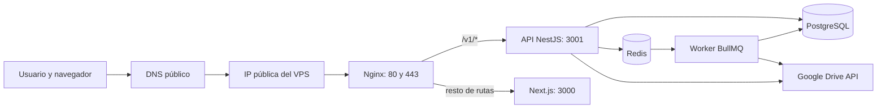
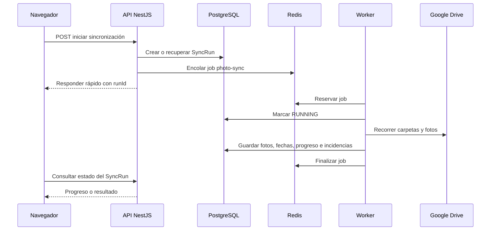

# CI/CD y despliegue en VPS: guía completa de Línea de vida

Esta guía explica, desde cero y con intención didáctica, cómo construimos el sistema de integración continua, entrega continua y despliegue de Línea de vida. No describe una arquitectura ideal inventada después de los hechos: documenta la arquitectura real, las decisiones que tomamos, las alternativas que descartamos, los fallos que aparecieron durante el primer despliegue y lo que aprendimos al resolverlos.

El objetivo es que una persona sin experiencia previa pueda entender no solo qué comandos ejecutamos, sino qué problema resuelve cada pieza y cómo circula una petición desde Internet hasta la aplicación.

> Nota de seguridad: los dominios, correos, direcciones IP, claves y contraseñas se representan mediante nombres genéricos. Los secretos reales viven en GitHub y en el archivo `.env` del VPS; nunca deben escribirse en este documento ni subirse al repositorio.

## 1. El resultado final, antes de entrar en detalles

Cuando un cambio llega a `main`, GitHub Actions realiza dos trabajos distintos:

1. **CI o integración continua:** instala las dependencias en una máquina limpia, genera Prisma Client, comprueba el formato, ejecuta lint, valida tipos, lanza los tests y construye las aplicaciones.
2. **CD o despliegue continuo:** abre una conexión SSH segura con el VPS, actualiza el archivo de entorno, descarga la revisión de `main`, construye las imágenes Docker, ejecuta migraciones, arranca los servicios y espera a que sus health checks confirmen que están sanos.

En producción, Docker Compose mantiene estos servicios:

| Servicio      | Responsabilidad                                   | Público en Internet  |
| ------------- | ------------------------------------------------- | -------------------- |
| PostgreSQL    | Persistencia principal                            | No                   |
| Redis         | Cola de trabajos de BullMQ                        | No                   |
| `migrate`     | Aplicar migraciones Prisma una vez por despliegue | No                   |
| API NestJS    | Autenticación, Google Drive, timeline y datos     | No                   |
| Worker BullMQ | Procesamiento asíncrono de carpetas y fotos       | No                   |
| Web Next.js   | Interfaz de usuario                               | No                   |
| Nginx         | Entrada pública, proxy inverso y TLS              | Sí, puertos 80 y 443 |
| Certbot       | Emisión y renovación puntual de certificados      | No, solo bajo perfil |

El tráfico sigue este recorrido:



La idea más importante es esta: **Nginx es la única puerta pública**. PostgreSQL, Redis, API, worker y web viven en una red privada de Docker y no publican puertos al host.

## 2. Conceptos básicos

### 2.1 Qué es integración continua

Integración continua, o CI, significa comprobar automáticamente cada cambio en un entorno limpio. “Limpio” es importante: evita que algo funcione solo porque el ordenador del desarrollador conserva archivos generados, dependencias antiguas o variables locales.

La CI responde preguntas como estas:

- ¿El lockfile describe exactamente las dependencias instalables?
- ¿Prisma Client puede generarse desde cero?
- ¿Todo el código cumple el formato acordado?
- ¿Hay errores detectables por ESLint?
- ¿TypeScript puede validar los tipos?
- ¿Los tests pasan?
- ¿Next.js y NestJS pueden generar artefactos de producción?

Una CI verde no garantiza que producción vaya a funcionar. Sí demuestra que el código supera un conjunto concreto y repetible de controles antes de desplegarse.

### 2.2 Qué es entrega y despliegue continuos

“Entrega continua” suele significar que el software siempre queda listo para desplegar. “Despliegue continuo” significa que, además, el despliegue ocurre automáticamente tras superar las condiciones acordadas.

En este proyecto, un `push` a `main` activa el workflow de producción. Por eso `main` funciona como rama desplegable: fusionar una PR no es solo organizar Git, sino iniciar una operación sobre el VPS.

### 2.3 Qué es un VPS

Un VPS es una máquina virtual alquilada que permanece encendida en un centro de datos. A diferencia de Vercel, Render o Railway, el proveedor del VPS entrega principalmente una máquina: nosotros somos responsables de instalar Docker, configurar el firewall, gestionar procesos, certificados, copias de seguridad y actualizaciones.

Ventajas:

- control total;
- coste predecible;
- posibilidad de ejecutar web, API, worker, base de datos y Redis en la misma máquina;
- aprendizaje real de infraestructura.

Desventajas:

- más responsabilidad operativa;
- los errores de permisos, disco, memoria o red son nuestros;
- no hay despliegues inmutables, métricas ni rollback avanzado “gratis”;
- la misma máquina concentra varios puntos de fallo.

### 2.4 Qué es Docker

Docker empaqueta una aplicación junto con su runtime y dependencias. Una **imagen** es la plantilla construida; un **contenedor** es una instancia ejecutándose de esa imagen.

Una analogía útil:

- `Dockerfile`: receta de cocina;
- imagen: plato preparado y empaquetado;
- contenedor: una porción abierta y servida;
- volumen: despensa persistente que no desaparece al cambiar el recipiente;
- red Docker: pasillo privado por el que se comunican los servicios.

### 2.5 Qué es Docker Compose

Docker Compose describe varios contenedores que forman una aplicación. En nuestro caso permite expresar:

- qué imagen utiliza cada servicio;
- qué comando ejecuta;
- qué variables recibe;
- de qué servicios depende;
- qué volúmenes conserva;
- qué puertos publica;
- cómo se comprueba su salud.

Sin Compose tendríamos que ejecutar muchos comandos `docker run` manuales y recordar redes, volúmenes y dependencias. Compose convierte esa configuración en un archivo versionado y revisable: `docker-compose.production.yml`.

## 3. Por qué elegimos esta arquitectura

### 3.1 Docker Compose en lugar de instalar Node directamente

Podríamos haber instalado Node.js, pnpm, PostgreSQL, Redis, Nginx y todas las dependencias directamente en Ubuntu. Es una solución válida para aplicaciones pequeñas, pero introduce diferencias entre máquinas y hace más difícil reproducir o revertir el entorno.

Elegimos Docker Compose porque:

- API, web y worker usan exactamente la misma versión de Node que declaramos;
- PostgreSQL y Redis quedan aislados;
- los servicios arrancan con una topología declarativa;
- los health checks y dependencias son visibles en el repositorio;
- actualizar una aplicación consiste en recrear contenedores, no en modificar manualmente procesos del host.

La contrapartida es que Docker consume recursos y añade una capa que hay que comprender. Además, la primera versión construía imágenes dentro del VPS, lo que puede cargar CPU y memoria durante el build.

### 3.2 Nginx en lugar de exponer Next.js y NestJS

Podríamos publicar el puerto 3000 de Next.js y el 3001 de NestJS. No lo hicimos porque obligaría al navegador a conocer dos orígenes y expondría directamente procesos de aplicación.

Nginx centraliza:

- puertos públicos 80 y 443;
- terminación TLS;
- redirección de HTTP a HTTPS;
- encaminamiento `/v1/*` hacia la API;
- encaminamiento del resto hacia Next.js;
- cabeceras `X-Forwarded-*` para que la API conozca protocolo, host e IP originales;
- futura aplicación de límites, caché o cabeceras de seguridad.

Alternativas:

| Alternativa       | Ventaja                                    | Coste o motivo para no elegirla                                        |
| ----------------- | ------------------------------------------ | ---------------------------------------------------------------------- |
| Caddy             | HTTPS automático y configuración muy corta | Queríamos controlar explícitamente Nginx y Certbot                     |
| Traefik           | Descubrimiento dinámico de contenedores    | Más complejidad para una sola aplicación                               |
| HAProxy           | Proxy muy potente y eficiente              | Menos cómodo para servir desafíos ACME y configuración web general     |
| Exponer Next/Nest | Configuración inicial mínima               | Peor aislamiento, CORS más complejo y sin terminación TLS centralizada |

### 3.3 GitHub Actions por SSH

GitHub Actions se conecta al VPS mediante SSH y ejecuta el despliegue allí. Es fácil de entender y no requiere instalar un runner de GitHub en el servidor.

Alternativas:

- **Runner autohospedado:** evita conexiones SSH salientes desde GitHub, pero instala un agente con acceso sensible en el VPS.
- **Webhook en el VPS:** un servicio recibe eventos y despliega, pero hay que desarrollar y proteger ese servicio.
- **Registro de imágenes:** GitHub construye imágenes, las publica en GHCR y el VPS solo hace `docker compose pull`. Es una mejora importante porque reduce carga y duración del SSH; la arquitectura actual todavía construye en el VPS.
- **Plataforma PaaS:** Render, Fly.io, Railway o similares abstraen casi toda esta operación, a cambio de menos control y otro modelo de coste.

### 3.4 PostgreSQL y Redis dentro del mismo VPS

Para empezar, simplifica el despliegue y reduce costes. Ambos servicios son privados y guardan datos en volúmenes Docker.

La alternativa profesional para crecer sería usar PostgreSQL y Redis gestionados. Eso mejora backups, alta disponibilidad y actualizaciones, pero añade coste y dependencia de un proveedor.

## 4. Preparación del repositorio

### 4.1 Monorepo y pnpm

El repositorio contiene al menos dos aplicaciones:

- `apps/api`: NestJS, Prisma, Google Drive y worker;
- `apps/web`: Next.js.

pnpm administra los workspaces. En la raíz, los scripts ejecutan operaciones recursivas:

```json
{
  "build": "pnpm -r build",
  "lint": "pnpm -r lint",
  "typecheck": "pnpm -r typecheck",
  "test": "pnpm -r test",
  "format": "oxfmt",
  "format:check": "oxfmt --check"
}
```

El lockfile `pnpm-lock.yaml` fija las versiones resueltas. CI utiliza `pnpm install --frozen-lockfile`: si `package.json` y el lockfile no coinciden, falla en vez de modificarlo silenciosamente.

### 4.2 Oxfmt como formateador

Inicialmente se utilizó Prettier. Después migramos a Oxfmt para un formateo rápido y uniforme. La CI ejecuta `pnpm format:check`; no reescribe archivos, solo falla si el repositorio no está formateado.

Esto produjo un aprendizaje práctico: un cambio funcional puede pasar tests y aun así bloquear la PR porque el formato forma parte del contrato del proyecto. Ocurrió con `docker-compose.production.yml`; la solución fue ejecutar Oxfmt sobre el archivo y subir un commit exclusivamente de formato.

## 5. El workflow de CI

El archivo `.github/workflows/ci.yml` se activa:

- en cada pull request;
- en cada push a `main`.

### 5.1 Checkout

```yaml
- uses: actions/checkout@v4
```

Descarga el commit dentro de una máquina temporal de GitHub. Cada ejecución empieza sin los `node_modules` ni los artefactos locales del desarrollador.

### 5.2 pnpm y Node.js

```yaml
- uses: pnpm/action-setup@v4
  with:
    version: 9.15.4

- uses: actions/setup-node@v4
  with:
    node-version: 22
    cache: pnpm
```

Fijar versiones evita que una actualización inesperada cambie el comportamiento del pipeline. La caché acelera descargas, pero no sustituye el lockfile ni conserva un `node_modules` arbitrario.

### 5.3 Instalación reproducible

```bash
pnpm install --frozen-lockfile
```

Si una persona añade una dependencia a `package.json` pero olvida actualizar `pnpm-lock.yaml`, esta fase falla. Es deliberado: producción debe construir exactamente lo que fue revisado.

### 5.4 Generación de Prisma Client

```bash
pnpm --filter @linea-de-vida/api exec prisma generate
```

Prisma Client es código generado a partir de `schema.prisma`. En el ordenador local ya existía, pero una ejecución limpia de CI no lo encontraba en las ubicaciones esperadas. TypeScript informaba que faltaban enums y tipos de Prisma.

El primer aprendizaje importante fue: **no hay que asumir que los artefactos generados existen**. Añadimos un paso explícito antes de typecheck.

Alternativas:

- ejecutar `prisma generate` en un script `postinstall`;
- incluirlo dentro del script raíz de build;
- generar y versionar el cliente, opción normalmente desaconsejada.

Elegimos el paso explícito porque hace visible la dependencia y no modifica todos los contextos de instalación.

### 5.5 Controles de calidad

El orden actual es:

1. `pnpm format:check`;
2. `pnpm lint`;
3. `pnpm typecheck`;
4. `pnpm test`;
5. `pnpm build`.

El orden intenta fallar pronto en comprobaciones rápidas antes de gastar tiempo en el build.

### 5.6 Concurrencia

```yaml
concurrency:
  group: ci-${{ github.workflow }}-${{ github.ref }}
  cancel-in-progress: true
```

Si enviamos varios commits seguidos a la misma rama, GitHub cancela la CI antigua. No tiene sentido terminar de validar un commit que ya fue reemplazado.

## 6. El Dockerfile

El `Dockerfile` usa varias etapas.

### 6.1 Etapa `dependencies`

Parte de `node:22-alpine`, habilita Corepack, fija `/app` como directorio y copia primero los manifiestos de dependencias.

Copiar `package.json` y el lockfile antes que el código permite reutilizar la capa de `pnpm install` mientras las dependencias no cambien.

### 6.2 Etapa `build`

Copia el repositorio y ejecuta:

```bash
pnpm build
```

Esto genera:

- Next.js bajo `apps/web/.next`;
- NestJS bajo `apps/api/dist/src`;
- Prisma Client para la API.

`NEXT_PUBLIC_API_URL=/v1` se fija en build porque las variables `NEXT_PUBLIC_*` de Next.js se incorporan al JavaScript enviado al navegador. Usar `/v1` significa “mismo dominio que la página, ruta `/v1`”, evitando CORS y dominios distintos.

### 6.3 Etapa `runtime`

La etapa actual hereda de `build`, cambia `NODE_ENV` a producción y deja los artefactos disponibles. Es sencilla, pero no produce la imagen mínima posible: conserva herramientas y dependencias de build.

Mejora futura:

- copiar únicamente artefactos y dependencias de producción;
- usar `output: standalone` de Next.js;
- crear imágenes específicas para API y web;
- construir imágenes en GitHub y publicarlas en GHCR.

## 7. Docker Compose, servicio por servicio

### 7.1 Red privada

Todos los servicios pertenecen a la red `app`. Docker proporciona DNS interno por nombre de servicio:

- `postgres:5432` resuelve PostgreSQL;
- `redis:6379` resuelve Redis;
- `api:3001` resuelve NestJS;
- `web:3000` resuelve Next.js.

Estos nombres solo funcionan dentro de la red Docker. Desde Internet no se puede conectar directamente a ellos.

### 7.2 PostgreSQL

Usa `postgres:16-alpine`, guarda datos en `postgres-data` y comprueba salud con `pg_isready`.

El volumen es fundamental: un contenedor se puede borrar y recrear sin perder la base de datos. El volumen sí debe incluirse en la estrategia de backups; “persistente” no significa “respaldado”.

No publicamos `5432` en el host. Así evitamos exponer la base de datos a Internet.

### 7.3 Redis

Redis almacena la cola de BullMQ. Se activa AOF con `--appendonly yes` y se usa el volumen `redis-data`.

Su health check ejecuta `redis-cli ping`. Tampoco publica el puerto 6379.

Redis no sustituye PostgreSQL:

- PostgreSQL guarda el estado de negocio;
- Redis coordina trabajos pendientes y ejecución asíncrona.

### 7.4 Migraciones Prisma

`migrate` no es un servicio permanente. Se ejecuta una vez:

```bash
pnpm --filter @linea-de-vida/api exec prisma migrate deploy --schema prisma/schema.prisma
```

Es una compuerta: API y worker no arrancan hasta que las migraciones terminan correctamente.

Esto evita que una nueva versión de código utilice columnas o tablas que todavía no existen.

Alternativas:

- ejecutar migraciones desde GitHub Actions antes de Compose;
- migrar al arrancar la API;
- mantener una fase externa con una herramienta de release.

Separarlas en un servicio puntual hace explícito su resultado y permite usar `service_completed_successfully`.

### 7.5 API NestJS

Arranca con:

```bash
node apps/api/dist/src/main.js
```

Su endpoint de readiness consulta PostgreSQL. No se limita a preguntar “¿el proceso existe?”, sino “¿el proceso puede atender con su dependencia principal?”.

La diferencia entre health y readiness es conceptual:

- **liveness/health:** el proceso está vivo;
- **readiness:** está preparado para recibir tráfico.

### 7.6 Web Next.js

Compose establece `working_dir: /app/apps/web`, porque `next start` busca `.next` en el directorio actual. Arranca en `0.0.0.0:3000`, necesario para que Nginx lo alcance desde otro contenedor.

### 7.7 Nginx

Nginx publica:

```yaml
ports:
  - '80:80'
  - '443:443'
```

El script `deploy/nginx/start.sh` elige una única plantilla:

- HTTP si `ENABLE_HTTPS=false` o falta certificado;
- HTTPS si `ENABLE_HTTPS=true` y existen certificado y clave legibles.

Después aplica `envsubst`, valida con `nginx -t` y arranca Nginx en primer plano.

La plantilla HTTP sirve `/.well-known/acme-challenge/` para Certbot y envía tráfico al API o web. La plantilla HTTPS mantiene esa ruta en HTTP, redirige el resto a HTTPS y escucha en 443 con TLS 1.2 y 1.3.

Los destinos internos no se fijan a la dirección IP que tenían al arrancar Nginx. Ambas plantillas usan el DNS integrado de Docker, `127.0.0.11`, y upstreams compartidos con `resolve` para volver a resolver `api` y `web` cada cinco segundos. Esto importa porque Compose puede recrear un contenedor con otra IP privada mientras Nginx continúa ejecutándose.

### 7.8 Certbot

Certbot se declara bajo un perfil llamado `certbot`. No se inicia en cada `docker compose up`; se ejecuta de forma puntual:

```bash
docker compose --env-file .env \
  -f docker-compose.production.yml \
  --profile certbot run --rm certbot
```

Usa el método **webroot HTTP-01**:

1. Certbot coloca un archivo temporal en el volumen `certbot-webroot`.
2. Let's Encrypt solicita ese archivo por HTTP usando el dominio público.
3. Nginx lo sirve desde `/.well-known/acme-challenge/`.
4. Si la autoridad comprueba que controlamos el dominio, entrega el certificado.
5. Certbot guarda certificado y clave en el volumen `letsencrypt`.

## 8. Por qué el worker es un proceso separado

### 8.1 El problema que resuelve

Escanear una carpeta de Google Drive puede implicar:

- recorrer muchas subcarpetas;
- paginar resultados;
- descargar metadatos;
- interpretar fechas;
- leer sidecars JSON de Takeout;
- escribir muchas filas en PostgreSQL;
- reintentar cuando Google devuelve límites o errores temporales.

Si la API hiciera todo esto dentro de la petición HTTP, el navegador esperaría demasiado, Nginx podría agotar un timeout y una caída del proceso perdería el progreso.

Por eso la API no ejecuta la sincronización directamente. Registra un `SyncRun` y encola un trabajo en Redis.

### 8.2 Qué hacen BullMQ y Redis

BullMQ implementa una cola de trabajos sobre Redis.

El flujo es:



### 8.3 Por qué el worker debe estar siempre funcionando

La API puede aceptar la solicitud y encolar un trabajo aunque el worker esté caído. En ese caso el trabajo permanece en Redis, pero nadie lo procesa. Desde la perspectiva del usuario, la sincronización quedaría eternamente pendiente.

Por eso Compose declara el worker como servicio permanente con `restart: unless-stopped` y health check de proceso.

### 8.4 Concurrencia y reintentos

El worker crea una instancia BullMQ sobre la cola `photo-sync`. Su concurrencia está limitada. Cada job permite tres intentos con backoff exponencial y jitter.

El backoff evita golpear repetidamente Google Drive cuando responde con 429 o errores temporales. El jitter hace que varios reintentos no ocurran exactamente al mismo tiempo.

El procesamiento guarda checkpoints de carpetas pendientes y carpetas vistas. Si aparece un error transitorio, puede conservar el progreso en PostgreSQL en vez de comenzar necesariamente desde cero.

### 8.5 Alternativas al worker actual

| Alternativa               | Cuándo tendría sentido                                                      |
| ------------------------- | --------------------------------------------------------------------------- |
| Procesar dentro de la API | Tareas de pocos milisegundos, no este escaneo                               |
| Cron periódico            | Sincronizaciones programadas sin acción inmediata del usuario               |
| RabbitMQ                  | Enrutamiento de mensajes más complejo o múltiples consumidores heterogéneos |
| SQS/Cloud Tasks           | Infraestructura gestionada y despliegue cloud                               |
| Kubernetes Jobs           | Plataforma Kubernetes ya existente                                          |

BullMQ y Redis son adecuados aquí porque la aplicación ya necesita una cola sencilla en Node.js y puede operar dentro del mismo VPS.

## 9. Preparación del VPS

### 9.1 Paquetes y usuario

El VPS Ubuntu se preparó con:

- Git;
- Docker Engine;
- Docker Compose v2;
- certificados CA y utilidades básicas.

Se creó un usuario restringido llamado `deploy`. El objetivo es que GitHub Actions no entre como `root`.

El usuario pertenece al grupo `docker`, lo que le permite controlar Docker. Esto sigue siendo un permiso muy potente: pertenecer al grupo Docker equivale prácticamente a tener control administrativo sobre el host. Debe reservarse a usuarios de confianza.

### 9.2 Ruta del repositorio

El repositorio vive en:

```text
/srv/linea-de-vida
```

Todo el árbol debe pertenecer a `deploy:deploy`. Si root modifica archivos dentro, el siguiente `git checkout` puede fallar con `Permission denied`.

### 9.3 Dos pares de claves SSH distintos

Este punto produjo confusión y merece una explicación clara.

#### GitHub Actions hacia el VPS

- La clave privada se guarda en el secret `VPS_SSH_PRIVATE_KEY`.
- La clave pública está en `/home/deploy/.ssh/authorized_keys`.
- Sirve para que el runner de GitHub entre al VPS.

#### VPS hacia GitHub

- La clave privada permanece en el VPS.
- La clave pública se añade al repositorio como **Deploy Key** de solo lectura.
- Sirve para que `git fetch origin main` funcione desde el VPS.

No son la misma dirección ni la misma responsabilidad.

### 9.4 `known_hosts`

`VPS_KNOWN_HOSTS` guarda la identidad pública SSH del servidor. Evita que el runner confíe ciegamente en cualquier máquina que responda en esa IP.

La clave privada demuestra “soy GitHub Actions autorizado”. `known_hosts` demuestra “este es realmente mi VPS”. La autenticación segura necesita ambas direcciones de confianza.

### 9.5 Firewall

UFW quedó con política entrante restrictiva y únicamente estos puertos públicos:

| Puerto  | Uso                 |
| ------- | ------------------- |
| 22/TCP  | SSH                 |
| 80/TCP  | HTTP y desafío ACME |
| 443/TCP | HTTPS               |

PostgreSQL, Redis, Next.js y NestJS no se abrieron. También se comprobó que Docker podía publicar 80 y 443 con un contenedor temporal.

Si el proveedor ofrece un firewall externo, debe permitir los mismos puertos. UFW controla el sistema operativo; el firewall del proveedor puede bloquear el tráfico antes de que llegue al VPS.

## 10. DNS: cómo llega Internet al VPS

Una IP identifica la máquina, pero un dominio es necesario para una URL estable y para OAuth web con HTTPS.

Usamos un subdominio gratuito de DuckDNS. El registro `A` asocia:

```text
app-ejemplo.duckdns.org -> IP pública del VPS
```

Cuando el navegador solicita el dominio:

1. pregunta al sistema DNS qué IP corresponde al nombre;
2. recibe la IP del VPS;
3. abre TCP 443;
4. Nginx presenta el certificado TLS;
5. el navegador valida que el certificado pertenece al dominio;
6. Nginx envía la petición al servicio interno adecuado.

DuckDNS no transporta el tráfico ni aloja la app. Solo publica la asociación nombre-IP.

Alternativas:

- dominio propio con DNS del registrador;
- Cloudflare DNS;
- otro proveedor de DNS dinámico;
- usar solo IP, insuficiente para nuestro OAuth web de producción y peor para TLS/identidad.

## 11. Variables y secretos

GitHub usa un entorno llamado `production`. Allí se guardan:

| Secret                | Propósito                                   |
| --------------------- | ------------------------------------------- |
| `VPS_HOST`            | IP o nombre del VPS                         |
| `VPS_USER`            | Usuario `deploy`                            |
| `VPS_PORT`            | Puerto SSH                                  |
| `VPS_DEPLOY_PATH`     | Ruta del repositorio                        |
| `VPS_SSH_PRIVATE_KEY` | Acceso GitHub Actions -> VPS                |
| `VPS_KNOWN_HOSTS`     | Identidad SSH verificada del VPS            |
| `VPS_ENV_FILE`        | Contenido completo del `.env` de producción |

`VPS_ENV_FILE` contiene, entre otras categorías:

- PostgreSQL y `DATABASE_URL`;
- Redis;
- orígenes públicos HTTPS;
- secretos de sesión, cifrado y métricas;
- credenciales Google OAuth;
- callbacks OAuth;
- límites de sincronización, rate limiting y caché;
- `PUBLIC_DOMAIN`;
- `LETSENCRYPT_EMAIL`;
- `HSTS_MAX_AGE`;
- `ENABLE_HTTPS`.

El workflow escribe `.env` con `umask 077`, de forma que solo su propietario puede leerlo.

Reglas importantes:

- `.env` nunca se commitea;
- no se imprimen valores en logs;
- los placeholders deben sustituirse por valores reales y únicos;
- `POSTGRES_PASSWORD` y la contraseña incrustada en `DATABASE_URL` deben coincidir;
- `TOKEN_ENCRYPTION_KEY` debe tener el formato y longitud esperados;
- al introducir una variable nueva hay que actualizar tanto GitHub como el VPS actual si se va a usar antes del siguiente deploy.

## 12. El workflow de despliegue

### 12.1 Activación y exclusión mutua

Se activa en cada push a `main`.

```yaml
concurrency:
  group: production-deployment
  cancel-in-progress: false
```

Nunca queremos dos despliegues escribiendo sobre el mismo repositorio y los mismos contenedores simultáneamente. Tampoco cancelamos uno a mitad, porque dejar una operación de infraestructura interrumpida puede ser peor que esperar.

### 12.2 Validación de assets

Antes de tocar el VPS, se comprueba que existe `docker-compose.production.yml`. El primer workflow exigía también que el archivo existiera ya en el checkout antiguo del VPS. Eso bloqueaba precisamente el primer despliegue: el archivo solo llegaría después del fetch.

La corrección fue validar en GitHub que el commit lo contiene y, en el VPS, comprobar inicialmente solo:

- repositorio Git;
- Docker;
- Docker Compose v2.

### 12.3 Configuración SSH

El runner crea `~/.ssh`, escribe la clave privada con permiso 600 y carga `known_hosts`. Usa:

- `BatchMode=yes`, para no esperar contraseñas interactivas;
- `StrictHostKeyChecking=yes`, para rechazar hosts desconocidos.

### 12.4 Actualización del entorno

El contenido de `VPS_ENV_FILE` se codifica en Base64 para transportarlo por stdin y se decodifica directamente en `$VPS_DEPLOY_PATH/.env`.

Base64 no cifra. La protección real proviene de:

- secret de GitHub;
- conexión SSH;
- permisos 077 del archivo.

### 12.5 Actualización del código

Dentro del VPS:

```bash
git fetch --prune origin main
git checkout --detach origin/main
```

El checkout detached evita que el despliegue gestione una rama local con commits propios. El VPS debe considerarse consumidor de artefactos, no lugar de desarrollo.

### 12.6 Arranque

```bash
docker compose -f docker-compose.production.yml \
  up --build --detach --remove-orphans
```

- `--build`: reconstruye imágenes si corresponde;
- `--detach`: deja servicios en segundo plano;
- `--remove-orphans`: elimina contenedores de servicios retirados de Compose.

### 12.7 Verificación de salud

El workflow obtiene los IDs y espera hasta 180 segundos. Si un contenedor declara `unhealthy`, no tiene health check o vence el plazo, falla.

Después de un incidente en el que solo veíamos un ID de contenedor, añadimos diagnóstico previo al rollback:

- estado de servicios Compose;
- nombre, estado y health de cada contenedor;
- últimas 100 líneas del servicio problemático.

Este cambio fue crucial: convirtió un “contenedor no sano” anónimo en una causa concreta de Nginx.

### 12.8 Rollback

El workflow guarda `previous_ref`. Si aparece un error, vuelve a esa revisión e intenta recrear el stack anterior.

Limitaciones actuales:

- un primer despliegue no tiene una revisión anterior con Compose;
- las migraciones de base de datos no se revierten automáticamente;
- el rollback reconstruye en el VPS y puede tardar;
- todavía debería verificarse formalmente la salud después del rollback;
- una revisión anterior podría no ser compatible con una migración ya aplicada.

Un rollback real no es simplemente “volver Git atrás”. Incluye compatibilidad de esquema, imágenes, configuración y datos.

## 13. HTTPS con Let's Encrypt

### 13.1 Por qué necesitamos HTTPS

HTTPS cifra el tráfico, autentica el dominio y protege cookies y tokens. Google OAuth exige redirect URIs HTTPS para aplicaciones web de producción.

### 13.2 Bootstrap en dos fases

Existe un problema circular:

- Nginx necesita certificado para arrancar HTTPS;
- Let's Encrypt necesita alcanzar Nginx por HTTP para entregar el certificado.

La solución es desplegar en dos fases:

1. `ENABLE_HTTPS=false`: Nginx arranca en HTTP y sirve el desafío ACME.
2. Certbot emite el certificado.
3. `ENABLE_HTTPS=true`: Nginx valida archivos y elige la plantilla HTTPS.

### 13.3 HSTS conservador

HSTS indica al navegador que use siempre HTTPS. Una configuración incorrecta puede bloquear el dominio durante mucho tiempo. Por eso comenzamos con:

```text
HSTS_MAX_AGE=0
```

Solo debe aumentarse después de verificar HTTPS, redirección, API y OAuth durante un periodo suficiente. No conviene activar `includeSubDomains` o `preload` sin revisar todo el dominio.

### 13.4 Renovación

Los certificados de Let's Encrypt tienen vida corta. Certbot debe ejecutar `renew` diariamente mediante cron o systemd timer. La mayoría de ejecuciones no renuevan nada; cuando el certificado entra en la ventana de renovación, obtiene uno nuevo y Nginx debe recargarse.

Alternativas:

- Certbot instalado en el host;
- Caddy con HTTPS automático;
- Traefik con ACME;
- certificado gestionado por Cloudflare o un balanceador externo.

Elegimos Certbot en Docker para mantener la infraestructura versionada junto a Compose.

## 14. Cronología de problemas reales y soluciones

Esta sección es especialmente valiosa: cada fallo revela una suposición incorrecta.

### 14.1 CI no encontraba tipos Prisma

**Síntoma:** TypeScript decía que faltaban enums y miembros de `@prisma/client`.

**Causa:** en local Prisma Client ya estaba generado; en CI, no.

**Solución:** ejecutar `prisma generate` explícitamente después de instalar dependencias.

**Lección:** probar en un checkout limpio descubre dependencias ocultas del entorno local.

### 14.2 El primer deploy exigía Compose antes de descargarlo

**Síntoma:** `Missing production Compose configuration` en el VPS.

**Causa:** el preflight buscaba el archivo nuevo en una revisión antigua antes de `git fetch`.

**Solución:** validar Git y Docker antes del checkout; usar el Compose después de descargar `main`.

**Lección:** el bootstrap inicial no tiene el mismo estado previo que una actualización normal.

### 14.3 Prisma CLI no existía en la raíz

**Síntoma:** `Cannot find module '/app/node_modules/prisma/build/index.js'`.

**Causa:** Prisma pertenece al workspace API de pnpm, no a la raíz física esperada.

**Solución:** invocarlo con `pnpm --filter @linea-de-vida/api exec prisma`.

**Lección:** con workspaces no debemos depender de rutas internas de `node_modules`.

### 14.4 Ruta duplicada del esquema Prisma

**Síntoma:** Prisma no encontraba `apps/api/prisma/schema.prisma`.

**Causa:** `pnpm --filter ... exec` ejecutaba desde `apps/api`; la ruta volvía a incluir `apps/api`.

**Solución:** usar `prisma/schema.prisma`, relativa al workspace.

**Lección:** una ruta relativa siempre depende del directorio de trabajo efectivo.

### 14.5 Next.js no encontraba `.next`

**Síntoma:** `Could not find a production build in the '.next' directory`.

**Causa:** el build existía en `/app/apps/web/.next`, pero `next start` se ejecutaba desde `/app`.

**Solución:** `working_dir: /app/apps/web`.

**Lección:** construir correctamente no basta; el comando de runtime debe buscar el artefacto donde realmente se generó.

### 14.6 NestJS no encontraba `main.js` ni `worker.js`

**Síntoma:** módulos inexistentes bajo `apps/api/dist/main.js` y `dist/worker.js`.

**Causa:** Nest emitía bajo `apps/api/dist/src`.

**Solución:** arrancar `dist/src/main.js` y `dist/src/worker.js`.

**Lección:** verificar físicamente los artefactos generados es mejor que inferir su ruta.

### 14.7 SSH se cortó durante un build

**Síntoma:** `client_loop: send disconnect: Broken pipe` y pérdida temporal de acceso hasta reiniciar.

**Causa:** no quedó demostrada. Tras el reinicio había memoria y swap disponibles; no apareció evidencia concluyente de OOM.

**Respuesta:** recuperar acceso desde consola del proveedor, comprobar memoria, disco, SSH y kernel; evitar afirmar una causa sin logs.

**Mejora futura:** construir imágenes en GitHub y descargarlas desde un registro reduce duración y carga del SSH.

### 14.8 Rollback de primera instalación

**Síntoma:** al volver al commit inicial, no existía `docker-compose.production.yml`.

**Causa:** el rollback asumía que toda revisión anterior ya contenía infraestructura de producción.

**Solución:** detectar revisiones anteriores a Compose y no intentar una restauración imposible.

**Lección:** el primer release es un caso especial.

### 14.9 El workflow ocultaba el servicio enfermo

**Síntoma:** solo aparecía un ID de contenedor `unhealthy` antes del rollback.

**Causa:** el script abortaba sin recopilar contexto.

**Solución:** diagnóstico acotado previo al rollback.

**Lección:** la observabilidad no es decoración; sin evidencia, cada fallo obliga a adivinar.

### 14.10 Permisos incorrectos en el checkout

**Síntoma:** Git no podía crear plantillas Nginx, y Nginx decía que faltaba `http.conf.template`.

**Causa:** partes de `/srv/linea-de-vida` pertenecían a root.

**Solución:** restaurar propiedad `deploy:deploy` y ejecutar Git como `deploy`.

**Lección:** no mezclar root y deploy dentro del working tree.

### 14.11 Cambios locales bloqueaban Git

**Síntoma:** `Your local changes would be overwritten by checkout`.

**Causa:** una recuperación manual había modificado un archivo tracked de Compose.

**Solución:** revisar el diff, preservar `.env` y restaurar únicamente el archivo tracked obsoleto.

**Lección:** el checkout de producción debe permanecer limpio. Las diferencias de entorno pertenecen a `.env`, volúmenes o archivos no versionados, no a editar Compose en el servidor.

### 14.12 Nginx activaba HTTPS antes del certificado

**Síntoma:** Nginx intentaba cargar `fullchain.pem` inexistente y reiniciaba.

**Causa:** el entrypoint oficial de Nginx procesaba automáticamente todas las plantillas colocadas en `/etc/nginx/templates`, incluida la HTTPS inactiva.

**Solución:** mover las plantillas a otra ruta y seleccionar exactamente una mediante nuestro `start.sh`.

**Lección:** una convención automática de una imagen base puede interferir con nuestro bootstrap.

### 14.13 El script de activación asumía que Nginx tenía OpenSSL

**Síntoma:** `sh: openssl: not found`.

**Causa:** `nginx:alpine` no incluye el ejecutable OpenSSL, aunque Nginx soporte TLS mediante sus bibliotecas.

**Solución operativa:** comprobar el certificado mediante `certbot certificates`, establecer `ENABLE_HTTPS=true`, recrear Nginx y ejecutar `nginx -t`.

**Pendiente técnico:** corregir `enable-https.sh` para no depender de un binario ausente.

**Lección:** una imagen mínima contiene menos herramientas de diagnóstico; los scripts deben validarse dentro de la imagen real.

### 14.14 URLs multimedia relativas en producción

**Síntoma:** `/timeline` lanzaba `URL constructor: / is not a valid URL` tras cargar fotos reales.

**Causa:** producción usa `NEXT_PUBLIC_API_URL=/v1`. El helper convertía esa URL en una base vacía y llamaba al constructor `URL` con `/` como base, algo inválido.

**Solución:** distinguir orígenes absolutos de rutas same-origin y conservar correctamente `/v1/photos/...`.

**Lección:** los datos reales ejercitan rutas que una pantalla vacía no toca; los tests deben cubrir configuración de producción, no solo localhost absoluto.

### 14.15 Nginx conservaba la IP de una API recreada

**Síntoma:** la web y Nginx respondían, pero las peticiones a `/v1/*` devolvían `502 Bad Gateway`. La API figuraba como sana y su endpoint `/v1/health` respondía correctamente desde el contenedor Nginx.

**Diagnóstico:** los logs mostraban que Nginx intentaba conectar con una dirección privada antigua. Una consulta nueva al nombre `api` mediante el DNS de Docker devolvía otra dirección, perteneciente al contenedor recién creado.

**Causa:** `docker compose up` recreó API y web durante el despliegue, pero mantuvo el contenedor Nginx existente. La configuración `proxy_pass http://api:3001` había resuelto el nombre al arrancar Nginx y conservó esa dirección después de que Compose sustituyera la API.

**Recuperación inmediata:** recrear únicamente Nginx para que resolviera de nuevo los nombres internos:

```bash
sudo -u deploy -- sh -c '
  cd /srv/linea-de-vida &&
  docker compose --env-file .env \
    -f docker-compose.production.yml \
    up -d --no-deps --force-recreate nginx
'
```

**Solución permanente:** declarar el resolver DNS integrado de Docker y upstreams dinámicos en las plantillas HTTP y HTTPS:

```nginx
resolver 127.0.0.11 valid=5s ipv6=off;

upstream api_backend {
    zone api_backend 64k;
    server api:3001 resolve;
}
```

El mismo patrón se aplica a `web`. Nginx puede actualizar las direcciones privadas sin reiniciarse cuando Compose recrea cualquiera de los dos servicios.

**Verificación:** comprobar que API y Nginx están sanos, consultar `/v1/health` a través de Nginx y revisar que los logs ya no contienen intentos de conexión hacia la dirección antigua.

**Lección:** un nombre de servicio Docker ofrece descubrimiento, pero el cliente decide cuándo vuelve a consultar DNS. Un health check que solo ejecuta `nginx -t` valida la sintaxis, no la conectividad con sus upstreams.

## 15. Operación cotidiana

### 15.1 Publicar una versión

1. Crear una rama.
2. Implementar el cambio y sus tests.
3. Ejecutar localmente formato, lint, typecheck, tests y build.
4. Abrir PR.
5. Esperar CI verde.
6. Fusionar a `main`.
7. Observar el workflow de producción hasta health checks verdes.
8. Verificar externamente página y `/v1/health`.

### 15.2 Consultar estado en el VPS

```bash
sudo -u deploy -- sh -c '
  cd /srv/linea-de-vida &&
  docker compose -f docker-compose.production.yml ps
'
```

### 15.3 Consultar logs

```bash
sudo -u deploy -- sh -c '
  cd /srv/linea-de-vida &&
  docker compose -f docker-compose.production.yml logs --tail 200 api worker nginx
'
```

No conviene imprimir `.env`, `docker inspect` completo o variables si el resultado va a compartirse públicamente.

### 15.4 Comprobar el repositorio

```bash
sudo -u deploy git -C /srv/linea-de-vida status --short
```

En condiciones normales no debe mostrar nada. Antes de borrar o restaurar una diferencia, siempre se revisa con `git diff`.

## 16. Qué mejoraríamos en una segunda iteración

### 16.1 Construir imágenes en CI

La mejora de mayor impacto sería:

1. GitHub Actions construye imágenes una sola vez.
2. Las etiqueta con el SHA del commit.
3. Las publica en GHCR.
4. El VPS hace `docker compose pull`.
5. Compose arranca exactamente esas imágenes.

Beneficios:

- menos CPU y RAM en el VPS;
- SSH mucho más corto;
- el artefacto probado es el artefacto desplegado;
- rollback por tag de imagen;
- despliegues más rápidos.

### 16.2 Rollback transaccional

El rollback debería:

- conservar imagen y Compose anteriores;
- validar compatibilidad de migraciones;
- ejecutar health checks después de restaurar;
- informar claramente si la restauración también falla.

Para cambios importantes podríamos adoptar blue/green: levantar una segunda versión, validarla y cambiar Nginx solo cuando esté sana.

### 16.3 Backups

Los volúmenes no son backups. Hace falta definir:

- `pg_dump` periódico;
- copia cifrada fuera del VPS;
- retención;
- prueba de restauración;
- política para certificados y configuración crítica.

### 16.4 Observabilidad

Sería útil añadir:

- métricas del host y contenedores;
- alertas de disco, memoria y health;
- logs centralizados o al menos rotación;
- alertas de jobs fallidos;
- monitor externo de HTTPS y expiración del certificado.

### 16.5 Seguridad del host

Revisiones recomendadas:

- desactivar autenticación SSH por contraseña;
- impedir login directo de root cuando el acceso alternativo esté probado;
- Fail2ban o protección equivalente;
- actualizaciones de seguridad;
- rotación de claves;
- mínimos permisos para GitHub Actions;
- firewall externo del proveedor.

### 16.6 Health checks más representativos

El worker solo comprueba que PID 1 existe. Un health check mejor verificaría conexión a Redis y que BullMQ está listo. Nginx podría comprobar una respuesta HTTPS local cuando TLS esté activo, no únicamente `nginx -t`.

## 17. Mapa de archivos

| Archivo                                      | Responsabilidad                                             |
| -------------------------------------------- | ----------------------------------------------------------- |
| `.github/workflows/ci.yml`                   | Validación automática del código                            |
| `.github/workflows/deploy-production.yml`    | Conexión SSH, despliegue, health y rollback                 |
| `Dockerfile`                                 | Construcción de API, worker y web                           |
| `.dockerignore`                              | Exclusión de archivos innecesarios o sensibles del contexto |
| `docker-compose.production.yml`              | Topología completa de producción                            |
| `.env.production.example`                    | Contrato de variables sin secretos reales                   |
| `deploy/nginx/start.sh`                      | Selección segura entre HTTP y HTTPS                         |
| `deploy/nginx/templates/http.conf.template`  | Bootstrap HTTP y ACME                                       |
| `deploy/nginx/templates/https.conf.template` | TLS, redirección y proxy                                    |
| `deploy/certbot/enable-https.sh`             | Activación TLS; actualmente requiere corrección             |
| `deploy/certbot/renew-certificates.sh`       | Renovación y recarga de Nginx                               |
| `apps/api/src/main.ts`                       | Proceso HTTP de NestJS                                      |
| `apps/api/src/worker.ts`                     | Consumidor BullMQ permanente                                |
| `apps/api/src/sync.service.ts`               | Encolado y ejecución de sincronizaciones                    |
| `apps/api/prisma/schema.prisma`              | Modelo de datos y generación de Prisma Client               |

## 18. Checklist de una infraestructura sana

### Repositorio y CI

- [ ] `pnpm install --frozen-lockfile` funciona.
- [ ] Prisma Client se genera explícitamente.
- [ ] Formato, lint, tipos, tests y build pasan.
- [ ] La PR está verde antes de fusionar.

### VPS

- [ ] El usuario `deploy` es propietario de `/srv/linea-de-vida`.
- [ ] El working tree está limpio.
- [ ] Docker y Compose v2 funcionan como `deploy`.
- [ ] UFW permite solo los puertos necesarios.
- [ ] PostgreSQL y Redis no publican puertos.
- [ ] Existen backups probados.

### GitHub

- [ ] Los siete secrets de conexión/despliegue están configurados.
- [ ] `VPS_ENV_FILE` contiene el entorno completo actualizado.
- [ ] La clave VPS -> GitHub es una Deploy Key de solo lectura.
- [ ] `known_hosts` fue verificado, no aceptado ciegamente.

### Aplicación

- [ ] Migraciones terminan con código 0.
- [ ] API, worker, web y Nginx están sanos.
- [ ] El worker consume la cola.
- [ ] `/v1/readiness` responde.
- [ ] Una sincronización real completa su `SyncRun`.

### Internet y TLS

- [ ] DNS resuelve a la IP correcta.
- [ ] HTTP permite ACME.
- [ ] HTTPS presenta certificado válido para el dominio.
- [ ] HTTP redirige a HTTPS después del bootstrap.
- [ ] OAuth tiene callbacks HTTPS exactos.
- [ ] La renovación automática está programada y observada.

## 19. Conclusión

El sistema final no es “un workflow que copia archivos”. Es una cadena de confianza y dependencias:

- Git y las PR controlan qué versión aceptamos;
- CI demuestra que el código puede instalarse, validarse y construirse desde cero;
- SSH autentica GitHub Actions frente al VPS y al VPS frente a GitHub;
- Docker hace reproducibles los procesos;
- Compose declara orden, red, volúmenes y salud;
- PostgreSQL conserva negocio;
- Redis y el worker desacoplan tareas largas;
- Nginx es la frontera pública;
- DNS convierte un nombre estable en una IP;
- Let's Encrypt demuestra control del dominio y cifra el tráfico;
- los health checks y logs permiten decidir si una versión está realmente lista.

Los fallos que encontramos no fueron tiempo perdido. Expusieron supuestos que solo aparecían en un entorno limpio o con datos reales: rutas relativas, directorios de trabajo, artefactos generados, permisos del host, bootstrap inicial, interacción con entrypoints de imágenes y observabilidad insuficiente.

La lección principal es que desplegar no consiste en “hacer que arranque una vez”. Consiste en construir un proceso repetible, observable, recuperable y comprensible por la siguiente persona que tenga que operarlo.
